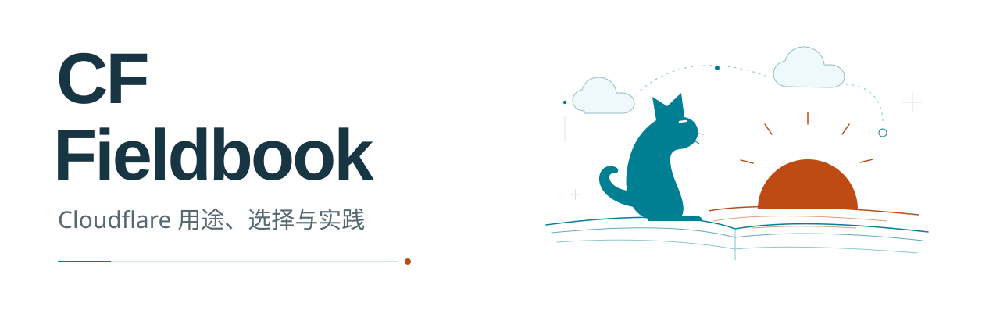

# CF Fieldbook

[](https://indeliblevivi.github.io/cf-fieldbook/)

**Cloudflare® 服务的用途、选择与实践参考。**

从手边的问题出发，认识相关服务，读实际系统遇到的故障与取舍，再运行一个能检查的小例子。面向个人开发者、独立创作者与协作 agent；这是 Faye & Cove 编辑的独立参考，不是 Cloudflare 官方文档或一键部署平台。

[在线阅读](https://indeliblevivi.github.io/cf-fieldbook/) · [源码仓库](https://github.com/IndelibleVivi/cf-fieldbook) · [作品与版本](https://indeliblevivi.github.io/cf-fieldbook/publications.html) · [变更记录](CHANGELOG.md)

正文以中文为主，Markdown 本身可以阅读；静态网站提供目录、来源跳转和本地搜索。代码、来源和出版工具留在同一仓库，便于在判断改变时找到受影响的内容。

## 从这里读

| 我现在想做什么 | 从这里开始 | 读完或运行后得到什么 |
|---|---|---|
| 先做完一个可读的小项目 | [三份文档的小资料架](examples/reading-shelf/README.md) | 打开成品或取得完整包，在本地阅读、下载原文、修改并重建，再按需要临时分享或持续公开 |
| 让朋友在我关机后仍能读公开资料 | [把同一个资料架公开发布](use-cases/publish-reading-shelf.md) | 准备独立发布目录，预览后按明确步骤部署、更新和停用 |
| 看服务在真实系统里怎样配合 | [三篇实践记录](practice/README.md) | 私有资料站的交付与检索、Access/PWA 重连、Tunnel 状态页的分层检查 |
| 给网页、API 或已有服务选入口 | [个人基础设施实践手册](guides/handbook.md) | 画清请求、身份、程序与数据的路径，再选择需要的服务 |
| 理解任务为什么登记了却没完成 | [任务中断与恢复](use-cases/recoverable-jobs.md) | 看见租约恢复、迟到拒绝与未知结果，知道哪些动作不能盲目重试 |
| 让模型建议下一步，而由程序控制执行 | [有限决策与下一步动作](use-cases/bounded-decision.md) | 区分模型建议、允许的动作与需要检验的误判 |
| 比较 Clef、Jev 与接入路线 | [服务页](services/decision-models.md) · [Clef / Jev 专题](comparisons/clef-vs-jev.md) | 在同一任务下比较模型与供应路径，不把价格当作正确率 |
| 判断近期产品变化是否影响自己 | [10 月 20 日观察](reports/2026-10-20.md) · [10 月 13 日](reports/2026-10-13.md) · [首发选编](reports/2026-10-first-release.md) | 检查费用、中文检索、字段抽取与执行边界，再回看完整产品地图 |
| 中文原文搜不到，或想从通知里抽字段 | [检索与样本](services/search.md) · [决策与字段抽取](services/decision-models.md) | 检查 tokenizer、短词和索引；区分有限选项、typed values 与生成 |
| 控制程序发出的云 API 或 HTTP 请求 | [云 API 与 HTTP 出站控制](services/egress-controls.md) | 确认代理、Gateway 与 Worker 实际检查的流量和条件 |
| 用程序盘点或维护 CF 资源 | [API 与 SDK 维护](reference/api-maintenance.md) · [可靠操作例子](examples/api-operations/README.md) | 选择调用入口，识别完整分页、总期限、部分失败与未知写结果 |
| 找回项目为什么这样选，判断变化是否相关 | [把变化接到当前项目](use-cases/project-context.md) · [项目判断任务单](templates/project-context-task.md) | 由 agent 读取已有理由与具体用法，区分命中、已查范围未发现和未知 |
| 运行例子，或把检查交给 agent | [五个离线例子](examples/README.md) · [恢复任务单](templates/job-recovery-task.md) | 用合成输入取得实际输出、失败证据与清理结果 |

不熟悉的词可以先查[术语小词表](docs/glossary.md)。需要精确配置、命令或完整状态约束时，从对应例子进入[实施参考](reference/implementation.md)。

资料架的接续只有一份材料：本地 HTTP 负责自己阅读；[临时分享](use-cases/temporary-sharing.md)把请求转回仍在运行的电脑；静态发布提供上传的公开文件。阅读站的完整 ZIP 保留 `examples/reading-shelf/` 目录和署名许可，解压后可直接沿用命令。发布工具是可选的 Node.js 22+／固定 Wrangler 开发依赖，默认 Python 阅读与构建不登录或部署。

三册之后的变化集中在[独立更新增补](reports/2026-10-update-supplement.md)：汇集 10 月 8 日、13 日与 20 日的资料，按检索、模型、执行、出站控制与维护连贯阅读。增补 PDF 已完成本地候选与检查，尚未发布为 GitHub Release。

## 先运行一个真实机制

**[先体验任务恢复模拟 →](https://indeliblevivi.github.io/cf-fieldbook/examples/job-state/demo.html)** 在浏览器选择合成情景、推进或回放时间，观察领取代次、租约和任务状态的变化。它是静态阅读站上的交互教学，不连接云服务。

只需 Python 3.11+，不登录、不联网、不调用模型：

```sh
python3 examples/job-state/demo.py
```

演示会打印：任务登记后仍是 `pending`；worker 退出后，新的执行者等待租约到期再领取；旧 generation 的迟到完成被拒绝；外部响应丢失后进入 `uncertain`，重复领取不会自动重放。临时 SQLite 在结束时清理。它验证一个恢复机制，不是完整云端队列实现；[使用边界](examples/job-state/README.md)也明确列出没有解决的外部动作崩溃窗口。

按[例子说明](examples/job-state/README.md)运行现有测试，可检查状态变化和重开数据库后的结果；[恢复任务单](templates/job-recovery-task.md)给出可直接交给 agent 的离线步骤。网页模拟、本地模型检查与实际云端恢复是三种不同证据，本仓库没有把前两者写成云端实测。

## 在本地阅读

Python 环境只负责生成静态文件，阅读页面不需要后端：

```sh
python3 -m venv .venv
.venv/bin/python -m pip install -r requirements-render.txt -r requirements-design.txt
.venv/bin/python tools/build_site.py
python3 -m http.server 8767 --bind 127.0.0.1 --directory .build/site
```

在浏览器打开 `http://127.0.0.1:8767`。依赖安装需要软件源网络；构建与阅读本身不请求云 API，没有追踪、登录或付费执行入口。也可直接阅读仓库 Markdown。网站的生成、附件与撤下规则见[阅读站说明](docs/reading-site.md)。

## 内容如何维护



[Mermaid 源码](diagrams/src/architecture.mmd) · [全部七张图](diagrams/README.md)

解释归 Markdown，跨页精确数据归 `catalog/`，执行行为归 `examples/`。三部作品的源条目、封面、章节类型与服务阅读入口归 `catalog/publications.json`；稳定章节 ID 与可见编号分开维护。网站与 PDF 读取这些来源；事实核验、代码测试和云端实测分别记录。服务页持续维护，带截止日期的报告保留当时判断。后来的改价不自动回写历史报告。

```sh
python3 tools/fieldbook.py impact data.decision-routes
python3 tools/fieldbook.py impact-source S117
python3 tools/fieldbook.py due --as-of 2026-11-01
python3 tools/fieldbook.py check
python3 tools/check.py
python3 tools/content.py check
.venv/bin/python -m unittest discover -s tests -v
node --test examples/health-worker/worker.test.mjs
```

Node.js 20+ 用于 Worker 测试；Mermaid 只在修改图示时需要安装。[贡献与维护](CONTRIBUTING.md)给出依赖、修改位置与验证方法；[出版流程](docs/publication.md)说明共源数据和冻结版次的构建。

`impact-source` 从登记条目的正文引用与 JSON `source` 单值／`sources` 数组定位，复用依赖查询生成复查候选。它不判定项目受影响、不读取外部 repo 或刷新核验日期。项目自身的目标、运行位置或功能改变时，也可用项目判断任务单取回相应机制；当前配置和采用理由仍由各项目自己的已有文档持有，私人证据留在仓库外。

10 月 13 日更新用它处理 Clef 价格／上下文与单值来源漏检；10 月 20 日再次从 S100 定位费用登记与当前正文，将 Observability 公布包含量同步为 10 GB-month，并审阅表外日期、解释与算例。`due` 只查登记的复核日，事实块检查也不证明整页说法正确；操作顺序与边界见[贡献与维护](CONTRIBUTING.md#完成一次来源更新)。

## 状态与边界

这是持续编辑的 source-available 参考仓库；具体实现、验证和未启用能力见[当前状态](docs/current-state.md)。[10 月 20 日观察](reports/2026-10-20.md)记录本轮定向更新；[10 月 13 日观察](reports/2026-10-13.md)保留上一轮资料；[2026.10 首发选编](reports/2026-10-first-release.md)继续保留 10 月 2 日主体和 10 月 3 日四组更新的时间位置。手册与报告按各自来源范围阅读，局部核查不表示全书重新核验。[实践记录](practice/README.md)匿名重构作者维护过的系统，保留历史观察日期，并链接相关官方机制文档。旧三册 Markdown / HTML / PDF 固定保留在 `dist/`，用于历史阅读；新构建进入 `.build/`，不覆盖旧版。新版 PDF 为本地首发候选，尚未发布为 Release。

公共例子使用合成输入，没有账号凭据或真实运行数据。阅读站由 GitHub Pages 托管，主分支通过检查后自动更新。搜索在浏览器内完成，不向搜索服务发送查询；站点不嵌入统计脚本或远程字体。云端实验、定期上游监控和新版出版物 Release 独立于网站部署。

PDF 构建保留可复制文字、链接和书签，并对本机 PingFang 的 CFF 字体封装作原生预览兼容处理；新文件仍须在实际阅读设备验收。字体嵌入或文字提取通过不能代替显示检查，见[出版流程](docs/publication.md)。

当前手册另有纳入 10 月 26 日资料的 31 页本地候选，已重新检查网页回访、字体与 macOS 显示，尚未登记为 Release 或“latest PDF”；其状态与旧版设备检查分开记录，见[当前状态](docs/current-state.md)。

原创功能代码采用 [SUL-1.0](LICENSE)；原创正文、出版物、独立图形和资料编排采用 [CC BY-NC-SA 4.0](LICENSE-DOCUMENTATION.md)。这是一份 source-available 项目，不是无商业使用限制的 OSI 开源软件；具体路径与第三方例外见[许可与权利范围](LICENSE-STATUS.md)。

[项目规格](SPEC.md) · [架构](docs/architecture.md) · [生命周期](docs/lifecycle.md) · [内容设计](docs/content-design.md) · [来源说明](docs/provenance.md) · [AGENTS](AGENTS.md)

Cloudflare 及相关产品商标属于 Cloudflare, Inc.；本项目与其没有隶属、赞助或背书关系。

---

GitHub · [github.com/IndelibleVivi](https://github.com/IndelibleVivi)  
*made by Faye & Cove*
