# 云 API 与 HTTP 出站控制

“客户端配置了代理”“Gateway 有策略”“Worker 已部署”分别只说明配置的一层。要判断一个云 API 或 HTTP 请求是否受到控制，应先画出口路径，再确认流量是否实际经过代理、是否被分类并可解密、哪条策略命中，以及最后是策略、Worker、上游还是凭据返回了错误。

本文在 2026-10-20 整理 Cloud Workload Security（CWS）Beta 与 Gateway Forward Workers public beta 的官方机制。两者面向的流量和运行位置不同：CWS 由用户自行运行的 proxy 检查发往云提供商的 API 请求；Gateway Forward 在用户流量已经进入 Cloudflare Gateway 并满足 HTTP 检查条件后调用 Worker。没有创建部署、安装 proxy、发出云 API 调用或修改 Gateway 策略；下面的表和路径均使用合成输入。

## 先画两条出口路径

```text
CWS:     client -> 自己运行的 cws-proxy -> 云提供商 API
                       |                     |
                     策略／Rego        凭据与资源权限

Forward: client -> Cloudflare Gateway -> GatewayMiddleware Worker -> 原目标
                       |          \-> next(request) 的上游回包
                     HTTP / body / response policy
```

左边能经过检查，不保证右边有权限；Worker 能运行，也不保证它看到的请求仍可安全重放。CWS 的 deployment token 只让 proxy 加载配置，不代替调用云 API 的凭据。Gateway Forward 的 Worker context 描述原请求，也不能证明外部动作已经成功。[S151] [S153] [S154]

## CWS：把云 API 请求交给自己运行的 proxy

CWS 于 **2026-10-19** 进入 Beta：在 Cloudflare dashboard 管理 workloads、policies 与 policy sets，在调用方环境运行 `cws-proxy`，让发往云提供商的 API 请求经过它再执行 request filters 与 Rego 检查。官方例子是阻止把 R2 bucket 变成 public 的请求。策略可以检查参数和 request-body 字段，因此“请求已到达 proxy”与“策略从请求正文得出了允许或拒绝”是两个观察。[S151] [S152]

CWS 需要 Zero Trust subscription，**Zero Trust Free plan 足够**；这回答账户资格，不表示运行 proxy 的主机、带宽或维护成本为零。Platform 的标准配额包括 deployments 5、policy sets 10、workloads 10、policies 50、domain ACLs 10；创建 deployment 不会自动改客户端路由，应用必须实际使用 proxy 并信任其 CA。proxy 的放置、进程运行与清理仍由使用者承担。[S153]

### Linux、CA 和实际路由

官方入门路线在 Linux 主机或 VM 上使用 APT 或 DNF 安装 `cws-proxy`，需要 `curl` 与 `sudo`，并安装、登录 `cf` client。对 pipeline runner、application host 或 shared proxy，proxy 还要能在作业发出请求前运行；共享时把 `proxy.listen_addr` 设成受控的私有地址与端口，只向预期客户端开放。[S154] [S153]

HTTPS 检查需要 CA certificate 与匹配的 private key。官方排错同时区分 proxy 对客户端提供可信证书和 proxy 访问 Cloudflare API 的出站信任：前者对应 `proxy.tls_interception.ca_cert`、`ca_private_key`、客户端 CA trust，后者对应 `proxy.tls_interception.extra_root_cas`。Node.js 的 `cf` 客户端可用 `NODE_EXTRA_CA_CERTS` 信任 proxy CA；该变量不改变 proxy 自己的出站信任。私钥留在 proxy host，不能随公共文档或日志发布。[S155]

客户端要明确使用 proxy 地址。官方本地例子是 `127.0.0.1:8080`，并使用 `HTTP_PROXY`、`HTTPS_PROXY` 与 `http://` scheme；跨 host 或 container 时 loopback 不可达，需改成受控的可达地址。官方 CLI 路线还要求 Node.js 24.5 或更高、设置 `NODE_USE_ENV_PROXY=1`，并检查 `NO_PROXY` 没有绕过目标 origin。[S155]

### 没被分类的隧道不执行 request policy

“有一条 connection log”不等于“CWS 评估了 HTTP request”。官方排错明确写到，**未分类的目的地可能作为 raw tunnel 通过，不进行 request-policy 评估**。CONNECT 拒绝、分类失败和 policy 评估前的失败还可能有单独的 event；普通 request 记录缺失本身不能证明客户端绕过了 proxy。[S155]

实际操作上应同时保存：client proxy 设置、proxy startup 的 `remote_config_loaded` 与 `action_mapper_loaded`、目标是否被分类、request decision、命中的 policy set 与 policy、以及上游 response status。`remote_config_fetch_failed_keeping_current` 表示 refresh 失败并保留旧配置；dashboard 已保存也不证明 proxy 已应用，配置轮询间隔至少 30 秒，改成本地配置或进程环境后则要重启。[S155]

策略命中也要分层。deployment 要包含预期 policy set，policy 要在范围内并处于 Enforce；workload 的 exclusion 可以移除请求。non-enforcing policy 可以记录拒绝而不阻断，Default mode 与 error action 另算。请求正文过大时，proxy 可能记录 `request_body_inspection_skipped_too_large`，此时 `input.http.request.body` 为 `null`，依赖 body 的 Rego 不能视作已检查。`request.context` 会截断，JSON 日志字段也可能截断，不能用截断 audit 反推完整 policy list。[S155]

不依赖私人凭据的检查次序可以写成：

```text
1. 客户端是否真的指向代理？      检查进程环境、NO_PROXY、目标 origin
2. proxy 是否加载当前 deployment？  startup + refresh / retry 日志
3. request 是否被分类并评估？       decision、policy set、error outcome
4. 哪一层拒绝了请求？              ACL / CWS / cloud provider（分别看）
5. 结果是否可恢复？                不凭一次 403 判断全部层
```

第 4 步尤其不能合并：`CWS.Error` 可能是 proxy 策略拒绝；`request.outcome: allowed` 但 `upstream_status: 403` 则表示云提供商拒绝了已允许的请求，应检查调用方的 provider 凭据与资源权限。域名 ACL 甚至可以更早拒绝 CONNECT。deployment token 不等于客户端身份，也不替代云资源的授权。[S155]

## Gateway Forward：在已过滤 HTTP 流量上运行 Worker

2026-10-15 的公告把 Gateway and Workers integration 列为 **public beta on all Zero Trust plans**。Forward 只处理 HTTP policies 允许且匹配的流量；Worker 接收 request 与 Gateway context，其中含 connection metadata、可用时的 user identity 与 device posture。Gateway 负责 proxy connection、TLS decryption 与 upstream routing。HTTP request policies 先评估，original request body 在交给 Worker 前检查；body inspection 的 Block 可中断 Worker，final response 在返回用户前再检查。Workers 的普通 usage 仍按 Workers pricing，现有 Gateway 与 Workers limits 都适用。[S157] [S156]

Forward 只调用 Worker 的具名 `GatewayMiddleware.handle(request, context, next)`，不是默认的 `fetch()` handler。`request` 带原始请求 body stream；`context` 描述 Gateway 看到的原请求，Worker 改 request 不会改 context。`next(request)` 把请求送到原目的地并沿用 Gateway routing 与 egress configuration；普通 Workers `fetch()` 是独立 subrequest，不能假定它自动继承用户 Gateway policies 或 egress IP。[S156]



[Mermaid 源码](../diagrams/src/gateway-forward.mmd)

### 每一步实际检查什么

| 检查点 | 官方行为 | 监控／验收时看什么 |
|---|---|---|
| HTTP request policy | Block 可以阻止 Worker；未命中 Forward 的流量不调用 Worker | 先查 host、URL、method 与 identity／posture 是否命中预期 policy |
| Body inspection | 原 request body 在交给 Worker 前检查；body Block 可中断已启动的 Worker | 策略结果与调用记录分开；调用发生不等于 body inspection 成功 |
| Worker invocation | 第一个匹配的 Forward policy 选择 Worker | 对比策略 precedence、绑定 Worker ID 与 invocation log |
| `next()` | 保留原 destination URL／host；每次 invocation **零次或一次** | 目标未被改写；重复、并发或用于重试均不在支持范围 |
| Response | Worker 返回最终 `200`–`599`；HEAD 与 `204`／`205`／`304` 不得带 body | 错误的状态或 body 可能让请求失败 |
| Failure | invocation 或 Gateway／Worker communication 错误 fail closed | 不应期待 Gateway 自动绕过 Worker 去访问原站 |

Worker 可以改 request method、headers、cookies、body 或 upstream response，也可直接返回 synthetic response。Gateway 在 Worker 前检查 original body、在 Worker 后检查 final response（包括 synthetic response），**不会把 Worker 修改后的 request bytes 再检查一次 request-side DLP**。所以 Worker 不能把 redaction 当作用户请求绕过 DLP 的方法；它新添加的数据也得不到第二次 request-side DLP 扫描。Body inspection 结果、DLP matches 与 response selectors 不能选择 Worker。HTTPS 必须解密，匹配 Do Not Inspect 的流量不调用 Worker。[S156]

`this.ctx.waitUntil()` 适合返回 response 之后的短背景任务，但仍受 Workers execution limits，不是 durable job queue；需要 retries 或更长时间的工作应选择 Queues 或 Workflows。[S156]

### 哪些请求会绕过 Forward Worker

以下排除项不是“策略暂时失败”，而是该请求不会交给所选 Worker：

| 流量／条件 | 预期 |
|---|---|
| HTTPS 未解密或命中 Do Not Inspect | 不调用 Worker |
| WebSocket 与升级请求 | 直接连原 upstream，Worker 看不到 upgrade request 或 messages |
| Proxy `CONNECT` tunnel | 直接到原 upstream，不调用 Worker |
| HTTP trailers 等不支持的 protocol 形态 | 不调用 Worker |
| Cloudflare compute platform 经 Workers VPC、匹配 Forward policy | Gateway drop，不调用 Worker；应从 Forward scope 排除 |
| 没有匹配的 Forward policy | 继续正常流程，不调用 Worker |

另有生命周期陷阱：Gateway 在保存 Forward policy 时解析 Worker ID。删除 Worker 不会删除或禁用 policy；之后命中请求返回 HTTP `500` 且不访问 origin。删除前先改 policy 或删 policy；保存仍引用已删 Worker 的 policy 会得到 API error `2294`。Worker ID 用 32 位小写 hexadecimal，不能用名字或 `workers.dev` URL 代替。[S156]

### 博客示例与接口文档的差异

博客的 DLP 告警示例说：“A Worker bound to a Forward policy receives traffic whenever a data loss prevention (DLP) profile matches.” 这与 Forward traffic 接口页的口径不同：接口页明确说 body inspection 的结果、DLP matches 与 response selectors 不能用来选择 Worker。公开公告和接口在“DLP match 是否触发 Forward”这一点上尚未对齐，不能把博客示例直接当作可部署契约；实现前应以当前接口页和实际策略行为复核，并分别记录 DLP match 与 Worker 调用证据。[S158] [S156]

博客示例展示的是应用意图，不是替代接口文档的执行顺序。需要转换或返回 synthetic response 时，以 `GatewayMiddleware` 契约和转发页的限制为准。[S158] [S156]

## 两条路线的合成验收表

下面只记录应在获准测试环境中如何区分，不含真实账号输出：

| 合成请求 | CWS 应观察 | Forward 应观察 |
|---|---|---|
| 将一个测试 bucket 设为 public | deployment 已加载，目标已分类，Rego／policy 给出 block | 不是 CWS 路径；若由 Gateway 管控，先检查 HTTP／body policy 与 Worker 是否实际运行 |
| 访问未分类的 API host | 可能作为 raw tunnel 通过，未做 request-policy 评估 | 只有 Gateway 允许且命中 Forward 才进入 Worker；未解密 HTTPS 或 Do Not Inspect 不进入 |
| 云提供商返回 `403` | 若 outcome 为 `allowed` 且 upstream 状态为 `403`，查调用方云凭据 | 若 Worker 返回 synthetic `403`，查 Worker；若来自 `next()`，则查 upstream |
| 修改 Worker request body 后再转发 | 不适用 | request-side DLP 不复查修改后 bytes，需在 Worker 内显式处理允许的数据 |
| Worker 删除后仍有命中请求 | 不适用 | Forward policy 未随 Worker 删除，预计匹配请求 `500` |

同一类请求的这些结果分别证明 proxy／policy、Worker 与上游状态，不能互相替代。需要保留的最小证据是 synthetic target、时间窗、版本或 deployment、strategy decision、上游 response 与清理结果；不保存 token、私钥、cookie 或完整 request body。

## 判断哪条控制应在前面

需要统一管理**云管理 API 的语义操作**，且组织能把自运行的 proxy 放在真实调用路径上时，先评估 CWS。需要针对已进入 Gateway 的 HTTP request 做应用特定处理或返回 coaching response 时，再评估 Forward Worker；需要看完整 HTTPS 内容就必须先解决解密与客户端信任，不能假设策略自动覆盖隧道。[S151] [S156]

这不是对两项 beta 的产品排名。先确定谁的请求、哪种协议、谁能运行代理、谁承担 Workers 与主机费用、是否需要 body 上下文、失败时应阻断还是放行，再分别做策略命中与外部效果的验证。云资源最终动作仍由 cloud provider 的凭据和权限控制；Gateway 或 CWS 的控制记录不证明资源状态已经回读。

<!-- SOURCES -->

[S151]: https://developers.cloudflare.com/changelog/post/2026-10-19-cloud-workload-security-beta/ "Cloud Workload Security Beta 发布"
[S152]: https://developers.cloudflare.com/cloudflare-one/cloud-workload-security/ "Cloud Workload Security：workloads、policies 与 Rego"
[S153]: https://developers.cloudflare.com/cloudflare-one/cloud-workload-security/platform/ "Cloud Workload Security proxy 部署与平台条件"
[S154]: https://developers.cloudflare.com/cloudflare-one/cloud-workload-security/get-started/ "Cloud Workload Security 本地 proxy 入门"
[S155]: https://developers.cloudflare.com/cloudflare-one/cloud-workload-security/troubleshooting/ "Cloud Workload Security proxy、CA 与未分类隧道排错"
[S156]: https://developers.cloudflare.com/cloudflare-one/traffic-controls/integrate-workers/forward-traffic/ "Gateway Forward traffic：执行顺序、限制与故障"
[S157]: https://developers.cloudflare.com/changelog/post/2026-10-15-gateway-workers-public-beta/ "Gateway 与 Workers 集成进入 public beta"
[S158]: https://blog.cloudflare.com/programmable-gateway-dlp/ "可编程 Gateway 与 DLP 示例"
